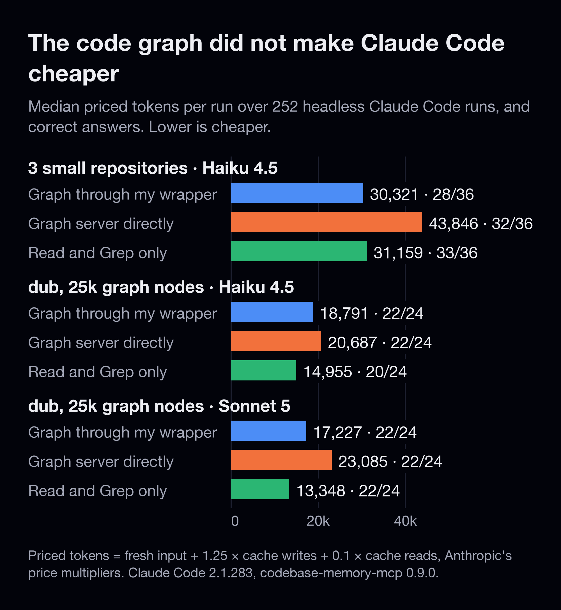
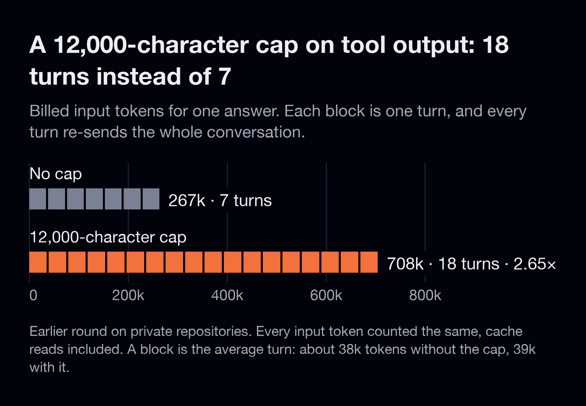
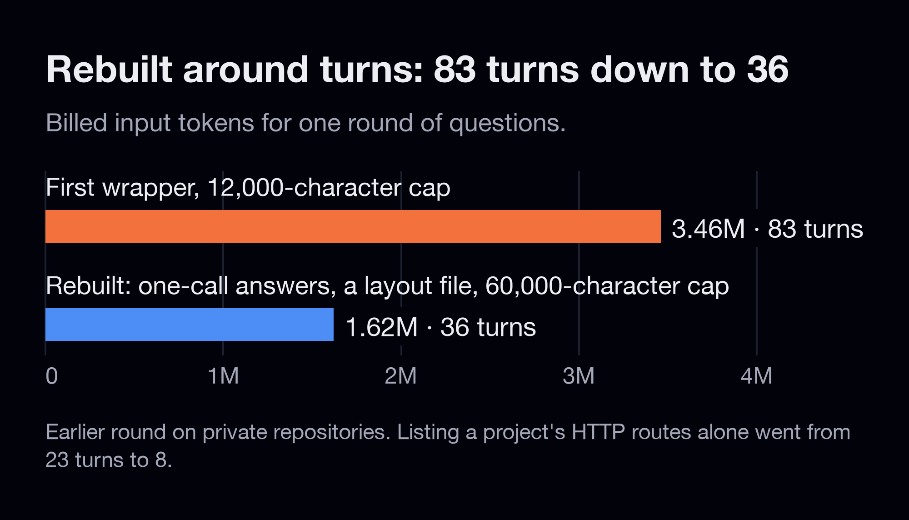
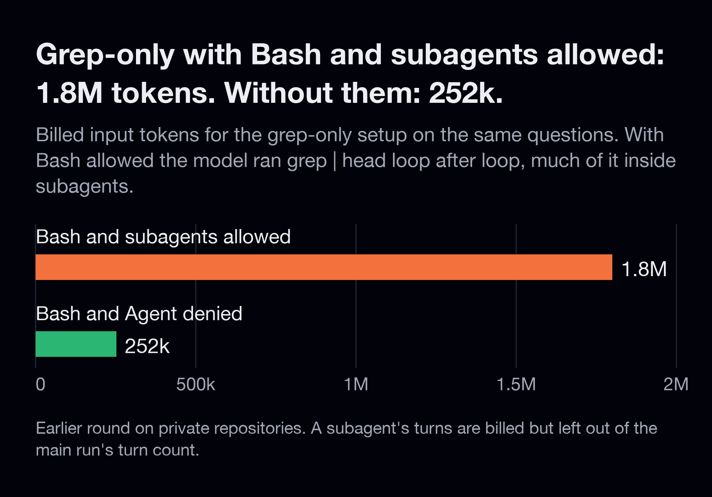
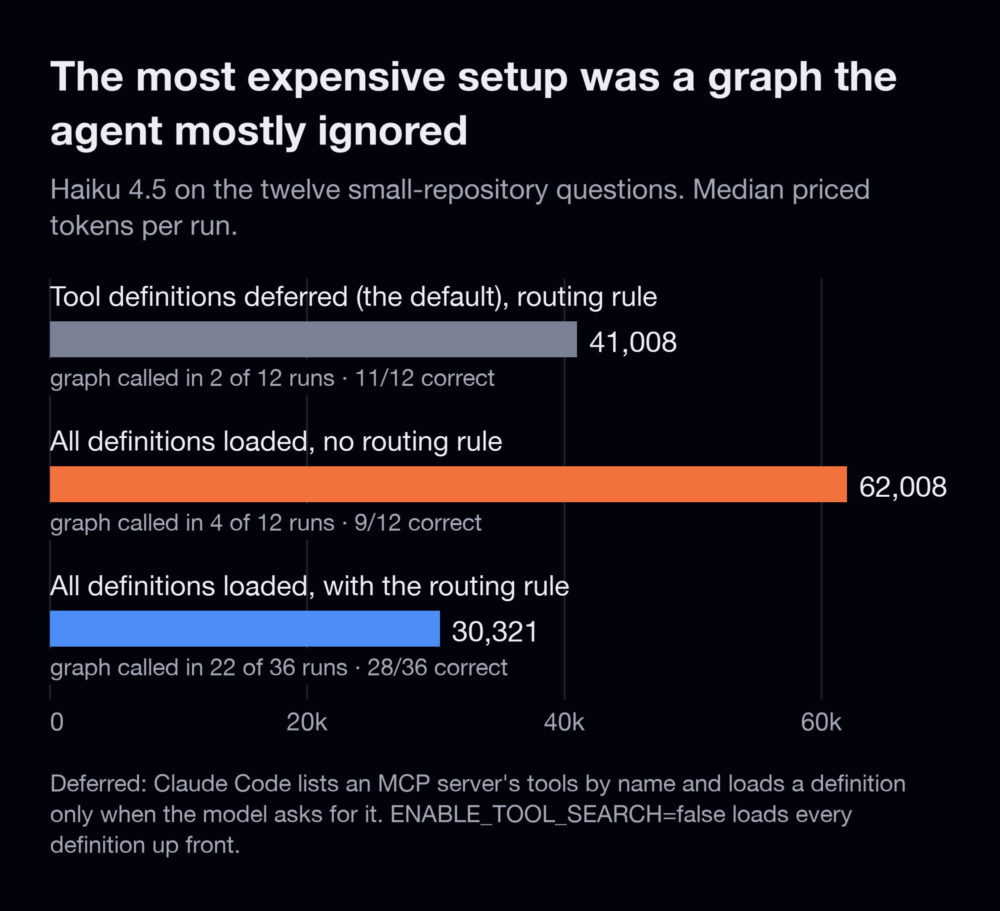
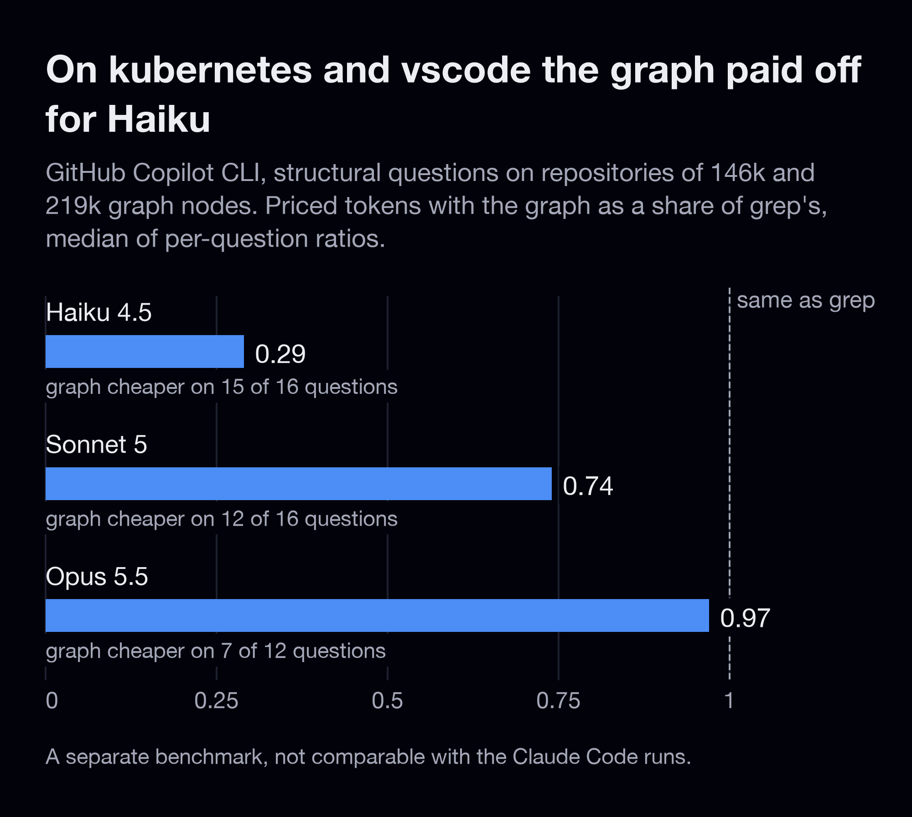
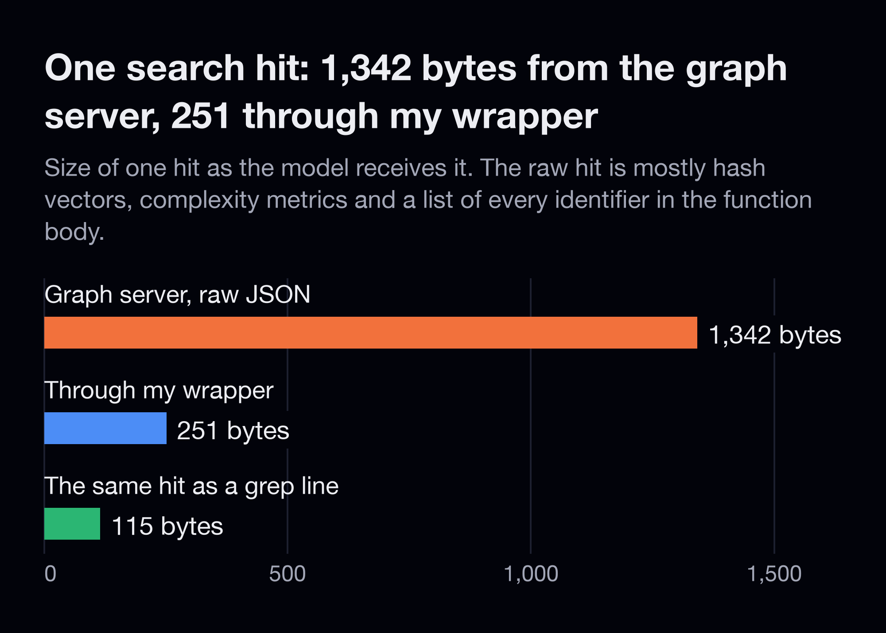

# Does a code graph make Claude Code cheaper?

A benchmark of 252 headless Claude Code runs on public repositories. Each run asks one question about the code, and
the benchmark counts every token, checks the answer and compares three setups: a code graph reached through my
wrapper, the same graph server used directly, and Claude Code's own Read and Grep. The runner, the wrapper and every
raw run, answers included, are in this repository.



The graph did not make Claude Code cheaper. On the three small repositories the wrapper and Read and Grep came out
level (p = 0.13). With Sonnet 5 on the large repository, Read and Grep were cheaper on 11 of 12 questions at the same
accuracy. The wrapper did beat the bare graph server in all three settings. The graph's one clear win was accuracy:
on the large repository Haiku answered the structural questions correctly 12 times out of 12 with it and 8 out of 12
without.

## Run it

You need Claude Code, Node 18 or newer, [codebase-memory-mcp](https://github.com/DeusData/codebase-memory-mcp) 0.9.0
on PATH, and Python 3 with numpy and scipy.

```sh
git clone https://github.com/nefayran/claude-code-token-bench && cd claude-code-token-bench
bash bench/setup.sh                      # clone three public repositories at pinned commits, build their graphs
node bench/run.mjs --reps 3              # 12 questions x 3 setups x 3 repetitions, each through claude -p
python3 bench/stats.py results/claude-*.json
```

`run.mjs` writes `results/<model>-<time>.json`. The 252 published runs cost $14.69 at API prices.

To see what share of your own Claude Code sessions' input came from the prompt cache, run
`node tools/cache-audit.mjs --days 7`. It reads Claude Code's local session logs and needs nothing else.

## Why the number of turns decides the bill


A turn is one round trip to the model. Each one is a new API request that carries the whole conversation: the system
prompt, the tool definitions, the question and every tool result so far. A change that makes responses smaller but
adds turns costs more than it saves.

I learned this in an earlier round on private repositories. To save tokens, my wrapper capped every response at
12,000 characters. The tool that returns a repository's structure hit the cap, the model got a shortened list with a
note saying how much was missing, and it asked again. That answer took 18 turns instead of 7, and its billed input
went from 267k tokens to 708k, 2.65 times as many. The average turn stayed about the same size: 38k tokens before the
cap, 39k after.



That round counted every input token the same, cache reads included, so 2.65 is a ratio of tokens, not of dollars.
Anthropic bills cache reads at a tenth of the input price, and the public benchmark above prices each kind of token at
its own rate.

The wrapper was then rebuilt around turns. One tool call now answers a whole structural question, a precomputed file
describes each repository's layout, and the cap went up to 60,000 characters. That round's questions went from 83
turns and 3.46M billed input tokens to 36 turns and 1.62M.



Bash and subagents hid more turns in the same round. With both allowed, the grep-only setup ran `grep | head` loop
after loop, much of it inside subagents, and was billed 1.8M input tokens. With both denied it needed 252k. Claude
Code's turn count covers only the main loop, so a subagent's turns are billed but missing from the count of the run
you're watching. Scoped Bash permissions don't match piped commands either: a grant for `grep` doesn't cover the
pipelines the model writes.



## What is inside

| path | what it is |
|---|---|
| `bench/run.mjs` | the runner: sends each question through `claude -p` under each setup and records tokens, turns, cost, the tools called and the answer |
| `bench/questions.json`, `bench/questions-large.json` | the questions, the repositories pinned to commits, and the strings a correct answer must contain |
| `bench/setup.sh` | clones the repositories and builds their graphs |
| `bench/stats.py` | medians, bootstrap intervals and Wilcoxon signed-rank tests |
| `results/*.json` | every run of the Claude Code benchmark, answers included |
| `bench/run-copilot.mjs`, `bench/questions-v2/`, `bench/PLAN-v2.md`, `results/v2/` | a second benchmark, in GitHub Copilot CLI on larger repositories |
| `server.mjs`, `digest.mjs` | the wrapper under test: an MCP server in front of codebase-memory-mcp |
| `tools/` | three small scripts for measuring your own sessions, listed under [Tools](#tools) |
| `docs/` | the charts and the video, and the two scripts that draw them |

## Results

### How the runs were set up

Claude Code 2.1.283 in headless mode: `claude -p`, one question per fresh session. Models: Claude Haiku 4.5 and
Claude Sonnet 5. Graph server: codebase-memory-mcp 0.9.0, an open-source MCP server that builds a graph of a
repository's symbols and the calls between them. MCP, the Model Context Protocol, is how Claude Code plugs in outside
tools.

Repositories: FastAPI's full-stack template, ltx-2-mlx and avoid-ai-writing, with 1.6k to 5k graph nodes each (a node
is one function, class, file or similar item), and dub, a link attribution platform, with 25k. The three small
repositories share twelve questions (6, 5 and 1) and dub has twelve of its own. In each set six questions are about
structure, such as who calls a function or the path from an endpoint down to the database write, and six ask for an
exact string, such as a config value or an error message. Every answer is checked for the facts it must contain.

Three setups, none of them allowed Bash or Agent:

- **Graph through my wrapper**: `server.mjs` in front of codebase-memory-mcp, plus a routing rule in the system prompt
  that says when to use the graph and when to use Grep.
- **Graph server directly**: codebase-memory-mcp on its own, with the same rule.
- **Read and Grep only**: Claude Code's built-in Read, Grep and Glob.

**Priced tokens** weigh each kind of input token by Anthropic's price multiplier: fresh input × 1, cache writes × 1.25,
cache reads × 0.1. p values are Wilcoxon signed-rank tests over per-question medians. In `results/*.json` priced
tokens are the `tokenEquiv` field, and the three setups are the `arm` values `graph`, `rawgraph` and `nograph`.

### Tokens and correct answers

| setting | my wrapper | graph server directly | Read and Grep | wrapper vs Read and Grep | wrapper vs graph server |
|---|---|---|---|---|---|
| 3 small repos (1.6k to 5k nodes), Haiku 4.5, 108 runs | 30,321 · 28/36 | 43,846 · 32/36 | 31,159 · 33/36 | no difference, p = 0.13 | cheaper on 8 of 12, p = 0.021 |
| dub (25k nodes), Haiku 4.5, 72 runs | 18,791 · 22/24 | 20,687 · 22/24 | 14,955 · 20/24 | no difference, p = 0.18 | cheaper on 11 of 12, p = 0.003 |
| dub (25k nodes), Sonnet 5, 72 runs | 17,227 · 22/24 | 23,085 · 22/24 | 13,348 · 22/24 | Read and Grep cheaper on 11 of 12, p = 0.034 | cheaper on 9 of 12, p = 0.007 |

Cells show median priced tokens per run and correct answers. In every setting the graph server used directly also
cost more than Read and Grep (p = 0.034, 0.012 and 0.007). Pilot runs are not included.

What this means in practice:

- Mounting a graph to save tokens did not work with Claude models on repositories up to 25k nodes.
- If you already use codebase-memory-mcp, reach it through the wrapper: it was cheaper than the bare server in all
  three settings.
- On dub, Haiku answered structural questions correctly 12 of 12 times with the graph and 8 of 12 with Read and
  Grep, at a median of 23.5k against 16.0k priced tokens on those questions. Sonnet got the same structural score
  either way.

<details>
<summary>Per question: three small repos, Haiku 4.5 (median priced tokens, correct of 3)</summary>

| question | my wrapper | graph server directly | Read and Grep |
|---|---|---|---|
| callers | 63,826 (3) | 97,124 (3) | 52,931 (3) |
| callees | 29,229 (3) | 40,739 (3) | 32,349 (3) |
| symbol-source | 38,410 (3) | 37,851 (3) | 37,873 (3) |
| architecture | 21,033 (3) | 31,394 (2) | 41,720 (1) |
| call-chain | 52,869 (1) | 101,061 (0) | 41,328 (3) |
| route-scan | 47,027 (3) | 59,494 (3) | 19,524 (3) |
| config-value | 34,577 (3) | 34,346 (3) | 18,977 (3) |
| env-flag | 60,184 (3) | 54,188 (3) | 65,035 (3) |
| error-string | 22,538 (1) | 29,088 (3) | 12,010 (3) |
| class-def | 11,983 (1) | 18,380 (3) | 11,207 (3) |
| const-value | 29,573 (1) | 48,706 (3) | 21,954 (2) |
| import-site | 19,942 (3) | 17,262 (3) | 15,379 (3) |

</details>

<details>
<summary>Per question: dub, Haiku 4.5 and Sonnet 5 (median priced tokens, correct of 2)</summary>

| question | Haiku, wrapper | Haiku, graph server | Haiku, Read and Grep | Sonnet, wrapper | Sonnet, graph server | Sonnet, Read and Grep |
|---|---|---|---|---|---|---|
| callers | 26,893 (2) | 31,821 (2) | 14,059 (2) | 19,459 (2) | 38,180 (2) | 10,624 (2) |
| callees | 13,478 (2) | 20,291 (2) | 15,428 (2) | 16,219 (2) | 29,525 (2) | 15,954 (2) |
| symbol-source | 17,141 (2) | 17,644 (2) | 11,648 (2) | 15,581 (2) | 29,539 (2) | 14,089 (2) |
| architecture | 27,475 (2) | 44,016 (1) | 27,120 (0) | 26,235 (0) | 22,234 (0) | 24,970 (0) |
| call-chain | 50,417 (2) | 78,342 (1) | 29,490 (0) | 43,680 (2) | 69,504 (2) | 34,951 (2) |
| route-scan | 19,752 (2) | 15,842 (2) | 14,699 (2) | 14,333 (2) | 12,958 (2) | 13,646 (2) |
| config-value | 31,798 (2) | 41,331 (2) | 52,154 (2) | 20,662 (2) | 39,254 (2) | 17,552 (2) |
| env-flag | 12,042 (2) | 15,372 (2) | 12,173 (2) | 10,268 (2) | 21,724 (2) | 9,839 (2) |
| error-string | 19,087 (2) | 40,159 (2) | 15,938 (2) | 19,770 (2) | 33,370 (2) | 33,210 (2) |
| class-def | 13,220 (0) | 14,111 (2) | 14,471 (2) | 9,848 (2) | 17,168 (2) | 9,244 (2) |
| const-value | 12,302 (2) | 18,988 (2) | 11,800 (2) | 10,180 (2) | 21,099 (2) | 9,712 (2) |
| import-site | 14,373 (2) | 23,352 (2) | 8,102 (2) | 14,597 (2) | 11,280 (2) | 10,199 (2) |

</details>

### Where each setup went wrong

- **Line numbers from the graph.** On exact questions the graph setups sometimes answered from graph output instead
  of grepping, as their rule told them to, and missed the line: login.py:33 instead of :34 (33 is the `if` above the
  `raise`), config.py:74 instead of :15 for a class the graph stores at 15 to 88, client.ts:129 instead of :59.
- **Duplicate names.** The FastAPI template has two handlers called create_user. Asked for the admin endpoint, both
  graph setups traced the unauthenticated one in 5 of 6 runs; Read and Grep found the superuser-guarded one every time.
- **Stopping early.** On dub, Haiku with Read and Grep missed the actual database write of a call chain in both runs.
- **A flawed check.** Every Sonnet run, in every setup, left `packages/tinybird` out of the dub architecture answer.
  That folder holds Tinybird data files and has no package.json, so the models were arguably right. All six Sonnet
  misses are this one question; treating it as unscorable changes no comparison above.

### Mounting a graph is not the same as using it



By default, Claude Code 2.1.283 lists an MCP server's tools by name and loads a tool's full definition only when the
model asks for it through its ToolSearch tool. In headless mode Haiku mostly didn't ask. The twelve small-repository
questions, one repetition each for the first two rows:

| setup | runs that called the graph | correct | median priced tokens |
|---|---|---|---|
| definitions deferred (the default), routing rule in the prompt | 2/12 | 11/12 | 41,008 |
| all definitions loaded, no rule | 4/12 | 9/12 | 62,008 |
| all definitions loaded, with the rule (the main run) | 22/36 | 28/36 | 30,321 |

In six pilot runs with the default, the graph was never called. With `ENABLE_TOOL_SEARCH=false` in the environment,
which loads every definition up front, the same callers question went through the graph in three turns. Loaded
definitions are paid for on every turn whether anything calls them or not, which made the mounted graph with no rule
the most expensive setup. Even with the rule, Sonnet used the graph in 10 of its 24 runs on dub and chose Grep for the
rest.

If you keep a graph mounted, load its definitions and tell the agent when to use it, for example in CLAUDE.md, the
instruction file Claude Code reads at the start of a session:

```
Structure (who calls what, call chains, routes, module layout, a symbol end to end): one graph_ask call.
Exact strings, config values, flags, error text: Grep and Read.
```

`graph_ask` is the wrapper's one-call tool; name your own server's tool there.

### Where a graph does pay: much larger repositories



A second benchmark ran in GitHub Copilot CLI 1.0.90 with the same wrapper, on four repositories, the largest being kubernetes
(146k nodes) and vscode (219k). There the graph cut Haiku's priced tokens on structural questions to 0.29 of grep's, and it
was cheaper on 15 of those 16 questions. Sonnet's went to 0.74 and Opus 5.5's to 0.97. The two harnesses have
different system prompts and tools, so these numbers compare with each other, not with the Claude Code runs. The plan
was written before the first run (`bench/PLAN-v2.md`), and the analysis is in `results/v2/stats.md`.

## The wrapper: server.mjs

A thin MCP server in front of codebase-memory-mcp. It gives an agent 11 short tools instead of the server's 14,
strips the fields no code question needs, and answers a whole structural question in one call.

```sh
claude mcp add code-graph --scope user -- node "$PWD/server.mjs"
printf '{"repo_path":"%s","mode":"fast"}' /path/to/repo | codebase-memory-mcp cli index_repository
node digest.mjs    # optional: one layout summary per indexed repository
```

Run the first line from this repository's folder. It needs Node 18 or newer and codebase-memory-mcp 0.9.0 on PATH
(or set `CBM_BIN` to its path). No npm dependencies.

- `graph_ask(project, kind, target)` answers a whole question in one round trip. Kinds: `symbol` (definition,
  source, callers, callees), `callers`, `callees`, `chain` (three hops of calls), `routes` (action path, handler,
  file:line and the URL-config files that hold the mount prefixes), `dead_code`, `hotspots`, `overview`, and
  `skeleton` (every signature in a file).
- It resolves names inside the call. The graph matches names exactly, so a near miss would return nothing and cost a
  turn to recover. `graph_ask` checks that the target exists and otherwise takes the top search hit, reporting the
  substitution in a `resolved` field.
- Batch forms: `graph_cypher(queries: [...])` and `graph_snippet(qualified_names: [...])` run several graph queries
  inside one tool call.
- It strips noise at any depth: `bt` (every identifier in the function body), the `sp` and `fp` hash vectors, and
  static metrics. A search hit drops from 1,342 to 251 bytes; unlisted fields pass through.
- The response cap is generous: 60,000 characters (`MAX_CHARS` in `server.mjs`). When it bites, the longest arrays are
  halved and labelled in the response, so the model gets valid JSON and knows what was left out.
- One failing sub-query comes back as `{error}` on its own instead of sinking the whole answer.
- It talks to codebase-memory-mcp over stdin JSON. The raw-JSON positional argument is deprecated in 0.9.0, and a
  child process fed through async `execFile` never sees EOF and hangs.



`digest.mjs` writes one Markdown summary per indexed repository into `~/.claude/cbm-digests/` (node kinds, a module
map, packages, layers, entry points, routes, hotspots), about 4.5 KB from one architecture call and one file query.
Each summary records the commit it was built from, so it goes stale with commits rather than with age.

### codebase-memory-mcp 0.9.0 traps

Each of these produced a wrong answer at some point:

- A small `max_rows` returns zero rows. On a query with 7 real rows, `max_rows: 200` returned all 7, while 10, 7
  and 3 returned nothing plus "Query returned no results. Use get_graph_schema()". Bound queries with `LIMIT`.
- The file property is `file_path`. `a.file` is in no schema, raises no error and yields an empty column.
- There is no NOT-pattern predicate: `WHERE NOT ()-[:CALLS]->(f)` is a parse error.
- There are no variable-length paths: `[:CALLS*1..3]` returns nothing, so hops are spelled out.
- Route handlers point at the route, `(handler)-[:HANDLES]->(:Route)`; the mirrored pattern matches nothing.
- The Route node holds the action path, not the mounted URL; the prefix lives in the framework's URL config.
- Next.js route handlers written as `export const GET = withWorkspace(...)` produce no Route nodes: dub has none.
- `labels(n)[0]` with `count(*)` does not aggregate; use `node_labels` from `get_architecture`.
- The server indexes per git repository; a folder that is not a repository has no index.

## How the benchmark keeps the comparison fair

Each of these was added because leaving it out gave a wrong conclusion earlier:

- Bash and Agent are denied in every setup. Scoped Bash grants do not match piped commands, and a setup that hands
  work to subagents hides turns while still paying for them.
- `--strict-mcp-config` loads only the MCP servers named on the command line, and `--setting-sources project` skips
  user-level settings, hooks and plugins, so nothing installed on the machine steers the model. The repositories
  live outside any folder with a CLAUDE.md above them, because Claude Code also loads those from parent directories.
- The routing rule goes only to the setups that have a graph. All tool definitions load up front unless
  `--tool-search default` is passed.
- The order of the setups rotates on each repetition. Back-to-back runs on one repository share a prompt cache, so a
  fixed order would give the later setups a warm-cache discount.
- A run that calls an MCP tool its setup does not own is marked invalid.
- Answers are kept: tokens saved on a wrong answer are not savings.

Each question runs like this, from the repository's checkout (this is the Read and Grep setup):

```sh
claude -p "Which functions or route files call createPaymentIntent? Ignore tests. Give the file:line of each call site, nothing else." \
  --output-format stream-json --verbose \
  --strict-mcp-config --setting-sources project --no-session-persistence \
  --allowedTools Read Grep Glob \
  --disallowedTools Bash Agent
```

More runs, as used for the published results (`--arms` picks setups by their `arm` names):

```sh
bash bench/setup.sh bench/questions-large.json
node bench/run.mjs --questions bench/questions-large.json --model claude-sonnet-5 --reps 2
node bench/run.mjs --arms graph --tool-search default --reps 1   # wrapper, tool definitions deferred
node bench/run.mjs --arms graph-unguided --reps 1                # wrapper, no routing rule
```

In headless mode nobody is there to approve a tool, so an MCP server's tools must be listed in `--allowedTools`. If
they are not, every call is refused while their definitions are still paid for, and the run looks cheap.

## Limits

- Every run is one question in a fresh session. In a long interactive session each extra turn re-sends a much longer
  history, and most of that history is read from the cache at a tenth of the price. Whether a tight cap costs more or
  less there than the 2.65 times measured here is open.
- In Claude Code the largest repository has 25k graph nodes, and Opus was not run. The larger repositories and Opus
  ran only in Copilot CLI.
- Two or three repetitions per question.
- The 12,000-character cap, the rebuild and the Bash numbers come from the earlier round on private repositories,
  which cannot be published. That round had also found the wrapper 26% cheaper than grep with Haiku and 18% with
  Sonnet, but it gave the routing rule to every setup, including the one with no graph, and that result did not
  reproduce on public repositories.
- A check looks for the facts a correct answer must contain, so one flawed check (the dub architecture question
  above) counts a defensible answer as wrong.

## Tools

- `tools/cache-audit.mjs`: the share of billed input served from the prompt cache in your own Claude Code sessions,
  overall and per project, with the worst sessions listed. `node tools/cache-audit.mjs --days 7`.
- `tools/mcp-tax.mjs`: the start-of-session token cost of an MCP server's tool definitions.
- `tools/llmlingua.py`: whether identifiers and signatures survive LLMLingua-2 compression on a code file.

## Charts and video

The images in `docs/images/` are drawn by two scripts. The charts of the Claude Code benchmark are computed from
`results/*.json`; the numbers from the earlier private round are constants at the top of the script.

```sh
pip install matplotlib pillow
python3 docs/make-charts.py
python3 docs/make-video.py    # needs ffmpeg
```

## License

MIT. codebase-memory-mcp is a separate project under its own license.

Written with AI assistance: an AI coding agent ran the benchmark and drafted the text under my direction.
